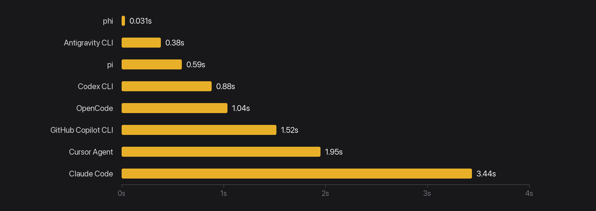
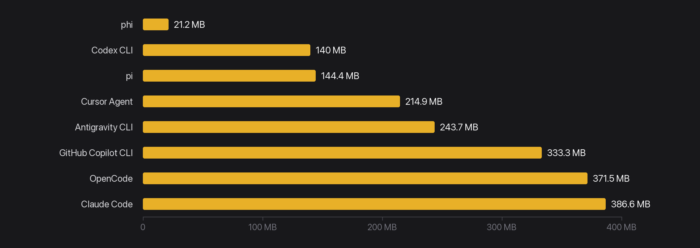
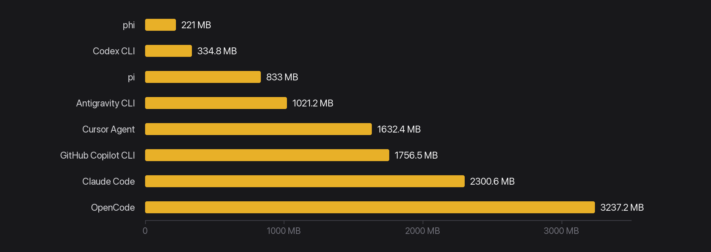

<p align="center">
  
</p>

<p align="center">
  <a href="https://pulseaiclub.github.io/"></a>
  <a href="https://discord.gg/UnyHB3tvRk"></a>
  <a href="README.md"></a>
  <a href="README.zh-CN.md"></a>
  <a href="https://github.com/pulseaiclub/phi/blob/main/LICENSE"></a>
  <a href="https://github.com/pulseaiclub/phi/actions"></a>
  <a href="https://go.dev"></a>
  <a href="https://github.com/pulseaiclub/phi/releases"></a>
</p>

- 15 MB · ~31 ms · alt ajanlar · çapalı esnek düzenlemeler · aşamalı MCP · PXB uzantıları · yerel diff inceleme ve kod seçimi · OpenAI / Anthropic / Gemini


- [Sponsorlar](#sponsorlar)
- [Belgeler](https://pulseaiclub.github.io/docs/getting-started/)
- [Hızlı başlangıç](#hızlı-başlangıç)
- [Kaynak kullanımı](#kaynak-kullanımı)
- [Yapılandırma](#yapılandırma)
- [Etkileşimli mod](#etkileşimli-mod)
- [Diff inceleme](#diff-inceleme)
- [Kod görüntüleyici](#kod-görüntüleyici)
- [Komutlar](#komutlar)
- [Oturumlar](#oturumlar)
- [Başsız mod](#başsız-mod)
- [Beceriler](#beceriler)
- [Uzantılar](#uzantılar)
- [MCP](#mcp)
- [Araçlar](#araçlar)
- [Proje düzeni](doc/project-layout.md)

## Sponsorlar

phi'ye sponsor olmak ister misiniz? <a href="mailto:zhengel2022@163.com">zhengel2022@163.com</a> adresinden ulaşın.

<table>
<tr>
<tr>
<td align="center" width="50%"><a href="https://mozhenzhen.com/go/phi"></a></td>
<td valign="top" width="50%">🐼 <strong>İş Ortağı Seçimi: Yapay zekaya fazla ödemeyi bırakın! Pahalı API'ler? Sahte modeller? Kazıklanıyor musunuz? Satın almadan önce <a href="https://mozhenzhen.com/go/phi">Mozhenzhen</a>'e göz atın:</strong><br/><br/>🏷️ <strong>Jetonlara fazla ödemekten bıktınız mı? [Fiyat Kontrolü]</strong> 2.000+ model · 350B+ ilan. Resmi abonelikleri, API aktarıcılarını ve kullandıkça öde fiyatlarını yan yana karşılaştırın.<br/>🛡️ <strong>Sahte veya kısılmış modellerden mi endişelisiniz? [Doğrulama]</strong> 5.000+ API aktarıcısı · 100B doğrulama raporu. Gerçek geliştirici incelemelerini kontrol edin ve model özgünlüğünü denetleyin.<br/>🧭 <strong>Güvenilir hesaplar veya bakiye yüklemeleri mi arıyorsunuz? [Hesap ve Yükleme Dizini]</strong> 1.200+ satıcı · 20B+ ürün (hesaplar, yüklemeler, ekip koltukları) peşin fiyat, teslimat hızı ve garanti koşullarıyla.<br/>🎁 <strong>Ücretsiz API kredisi mi arıyorsunuz? [Ücretsiz Avantajlar]</strong> Günlük güncellenen ücretsiz katmanlar, promosyonlar ve istediğiniz zaman alabileceğiniz topluluk aktarım merkezleri.<br/>⭐ <strong>Her Zaman Ücretsiz · Mozhenzhen yapay zeka hizmetleri satmaz — sıralamalar tamamen veri odaklıdır</strong> 👉 Şimdi kontrol edin: <a href="https://mozhenzhen.com/go/phi">mozhenzhen.com</a></td>
</tr>
</table>

## Hızlı başlangıç

En son sürümü kurun (macOS / Linux):

```sh
curl -fsSL https://raw.githubusercontent.com/pulseaiclub/phi/main/scripts/install.sh | bash
```

Windows (PowerShell 5.1+):

```powershell
irm https://raw.githubusercontent.com/pulseaiclub/phi/main/scripts/install.ps1 | iex
```

İlk başlatma bir model gerektirir. Yapılandırma düzenleyicisini açın (`~/.phi` düzenini oluşturur ve `~/.phi/config.yaml` dosyasını yazar):

```sh
phi config
```

Veya tek seferlik bir çalıştırma için ortam değişkenlerini ayarlayın:

```sh
export PHI_MODEL=gpt-4o
export PHI_API_KEY=sk-...
```

Ardından TUI'yi başlatın:

```sh
phi
```

Veya kaynaktan derleyin (Go 1.26.3+, bkz. `go.mod`):

```sh
make build          # ./phi üretir
make install        # derler ve $GOBIN içine kurar
```

İlk başlatmada phi, `~/.phi/` altında şu dizinleri otomatik olarak oluşturur:

- `bin/` — indirilen arama araçları (`fd`, `rg`)
- `skills/` — genel `SKILL.md` dosyaları
- `extensions/` — kurulu uzantılar (bkz. [doc/extensions.md](doc/extensions.md))
- `session/` — kalıcı oturumlar, proje dizini başına bir klasör
- `jobs/` — alt ajan dökümleri, iş başına bir klasör

Arama araçları (`fd`, `rg`) eksik olduğunda arka planda `~/.phi/bin` içine indirilir.

TUI, modele dört temel araç (`read`, `write`, `edit` ve `bash`) ile `grep`, `find` ve `ls` araçlarını sunar. Model isteklerinizi yerine getirmek için bunları kullanır. Harici HTTP getirme, yapılandırıldığında MCP üzerinden kullanılabilir.

## Kaynak kullanımı

Yalın olmak yetmez — phi anlık hissettirmek ve yük altında ekonomik kalmak için tasarlanmıştır.
phi değerleri macOS arm64 üzerinde soyulmuş bir sürüm derlemesidir (`CGO_ENABLED=0`, `-ldflags="-s -w"`).
Diğer çalıştırma ortamları yayımlanmış Linux PSS / etkileşimli PTY değerlerini kullanır.

### İlk kareye kadar geçen süre

<p align="center">
  
</p>

### Boşta RAM · 1 oturum

<p align="center">
  
</p>

### Boşta RAM · 10 oturum

<p align="center">
  
</p>

| Ölçüt | phi |
| --- | ---: |
| Sürüm ikili dosyası | **~15 MB** |
| Boşta RSS (1 oturum) | **~21 MB** |
| 10 boşta oturum (toplam RSS) | **~221 MB** |
| İlk kareye kadar süre | **~31 ms** (26–49 ms) |
| Soğuk `go build` (boş `GOCACHE`) | **~5.5 s** |
| Sıcak yeniden derleme | **~0.7 s** |
| Go kaynağı (testler hariç) | **~54k satır** (~49k boş olmayan) / 345 dosya |
| Go paketleri | **84** |
| Doğrudan modül bağımlılıkları | **8** |
| Bağlı çalışma zamanları | yalnızca sistem kütüphaneleri (Node / Electron / Python yok) |

Zamanlama, bellek ve boyut satırları yukarıdaki macOS arm64 kurulumunda ölçülmüştür ve ilk
yayımlandıklarından beri yeniden çalıştırılmamıştır. Kaynak, paket ve bağımlılık satırları
Kasım 2026'da (2026-11-11) main dalına karşı yeniden ölçülmüştür:

- Kaynak: kök modülde git tarafından izlenen test dışı `*.go` dosyaları (`ext/` hariç); `cloc` ve `tokei` mevcut olmadığı için `wc -l` (satırlar) ve `grep -cv '^\s*$'` (boş olmayan satırlar) ile sayılmıştır.
- Paketler: kök modülde `.go` dosyaları içeren dizinler (`ext/` ayrı bir modül olduğu için hariç), `go list ./...` ile eşdeğerdir.
- Doğrudan bağımlılıklar: `go.mod` içindeki `require` bloklarında `// indirect` olmayan girdiler.

## Yapılandırma

phi, `~/.phi/config.yaml` (standart YAML) dosyasını okur. Ortam değişkenleri tek seferlik çalıştırmalar için onu geçersiz kılar. `phi config` aynı dosya için tam ekran bir terminal düzenleyicisi açar — siz kaydedene kadar hiçbir şey yazılmaz ve önceki dosya `config.yaml.bak` olarak saklanır.

```
phi config keys
  ↑↓ ←→      gezin / bir değeri değiştir    a   bir model ekle
  ⏎          düzenle veya seçici aç          d   odaklanılan satırı sil
  esc        kapat veya çık                  f   sağlayıcıdan model kimliklerini getir
  ^s         kaydet                          s   kaydet        q  çık
```

Boş bir alan "ayarlanmamış", yani yükleyicinin dolduracağı değer anlamına gelir; yer tutucu o değeri gösterir.

```yaml
# ~/.phi/config.yaml
models:
  - name: gpt-4o
    api: OpenAI             # OpenAI | OpenAIResponses | Anthropic | Gemini (boş → OpenAI uyumlu)
    api_key: sk-...         # veya PHI_API_KEY ayarlayın
    base_url: https://api.openai.com/v1   # varsayılan; PHI_BASE_URL geçersiz kılar
    context_window: 128000  # isteğe bağlı
    default: true           # başlangıçta kullanılan model; yoksa ilk girdi kazanır
  - name: claude-sonnet-4-20250514
    api: Anthropic          # zorunlu — ad/URL tahmini yok
    api_key: sk-ant-...
    base_url: https://api.anthropic.com
    context_window: 200000
  - name: deepseek-flash    # yerleşik ön ayar: base_url / context / thinking doldurulur
    api_key: sk-...
  - name: gemini-2.5-flash  # yerleşik ön ayar (api: Gemini)
    api_key: ...
    think_level: high       # isteğe bağlı: off | minimal | low | medium | high | …

skill_path: ~/.phi/skills # SKILL.md dosyalarının yüklendiği yer; "~/…" genişletilir

agents:
  enabled: true           # varsayılan; agent_* alt ajan araçlarını devre dışı bırakmak için false yapın
  models:                 # isteğe bağlı rol başına varsayılanlar; atlanırsa üst modeli devralır
    explore: cheap-model
    review: strong-model
    worker: coding-model

```

Yerleşik ön ayarlar ve düşünme (thinking) aktarım biçimleri: [doc/models.md](doc/models.md).

Ortam geçersiz kılmaları:

| Değişken         | Geçersiz kıldığı |
| ---------------- | ------------------ |
| `PHI_API_KEY`    | `models[].api_key` (varsayılan model) |
| `PHI_MODEL`      | hiçbir model yapılandırılmadığında yedek model adı |
| `PHI_BASE_URL`   | `models[].base_url` (varsayılan model) |
| `PHI_SKILL_PATH` | `skill_path`       |
| `PHI_THINK_LEVEL` | `models[].think_level` (varsayılan model; `off` devre dışı bırakır) |
| `PHI_PROMPT_HISTORY` | İsteme yazıcı geçmişi geri çağırma (`on` etkinleştirir; varsayılan olarak kapalı, projenin oturum dizinine `prompts.json` yazar) |

Sağlayıcı yönlendirmesi açık `api` alanını (`OpenAI` / `Anthropic` / `Gemini`) kullanır. Bkz. [Desteklenen modeller](doc/models.md).

### Çalışma alanı düzeni

```
~/.phi/
├── config.yaml   # genel yapılandırma
├── bin/          # indirilen arama araçları (fd, ripgrep)
├── skills/       # SKILL.md beceri dizinleri
├── extensions/   # PXB ikili dosyaları + phi.yaml
├── jobs/         # alt ajan iş yapıtları (meta, logs, result.md)
└── session/      # kalıcı oturumlar, çalışma dizini başına bir dizin
    └── <encoded-cwd>/
```

## Etkileşimli mod

`phi` TUI'yi başlatır: üstte sohbet dökümü, altta bir düzenleyici ve geçerli etkinliği gösteren bir altbilgi. Daha yeni bir sürüm mevcut olduğunda altbilgi `0.2.0 available · phi update` gibi bir ipucu gösterir.

Asistan çıktısı Markdown (CommonMark/GFM) olarak işlenir: başlıklar, vurgu, üstü çizili metin, bağlantılar, alıntı blokları, listeler, görev onay kutuları ve tablolar etkin temayla biçimlendirilir; çitli kod blokları soluk bir dil başlığı ve dile göre sözdizimi vurgulama alır. Yapısal işaretçiler (`#`, `` ` ``, `*`) soyulur.

Düzenleyici şunları destekler:

- `@` — bulanık dosya bahsetme seçicisi (`@` yazın ve bir yol yazmaya başlayın)
- `/` — eğik çizgi komutu seçicisi (`/sessions`, `/branch`, `/skill`, `/new`, `/fork`, `/compact`, `/diff`, `/code`)
- `?` — kısayol yardım seçicisi (`/`, `!`, `!!`, `@` ve tuş atamalarını listeler; `Esc` kapatır)
- `!command` — yerel olarak bir kabuk komutu çalıştırın ve çıktısını döküme aktarın (bkz. [Komutlar](#komutlar))
- `Ctrl+K` — komut paleti: settings → model / theme / agents (rol başına modeller dahil) / thinking / debug, ayrıca uzantı yönetimi (`extensions`); bir beceri seçmek için `/skill` kullanın.

### Klavye kısayolları

| Tuş            | Eylem                          |
| -------------- | ------------------------------- |
| `Ctrl+C`       | phi'den çık                     |
| `Esc`          | Çalışan ajanı iptal et / seçicileri kapat |
| `Ctrl+K`       | Komut paletini aç/kapat         |
| `Ctrl+A`       | Satır başına atla               |
| `Ctrl+E`       | Satır sonuna atla               |
| `Ctrl+U`       | İstem girişini, görselleri ve becerileri temizle |
| `Ctrl+V`       | Metin yapıştır veya panodan bir görsel ekle |
| `Shift+Enter`  | İsteme yeni satır ekle          |
| `Ctrl+Shift+C` | Seçili döküm metnini kopyala    |

Temalar: `Dark` (varsayılan), `Darcula`, `Pink` ve `Terminal`; paletten settings → theme altından değiştirilebilir.

## Diff inceleme

`/diff`, TUI içinde tam ekran bir git incelemesidir — değişikliği okuyun, satır notları bırakın, ardından terminalden çıkmadan bunları ajana teslim edin.

| Komut | Ne açar |
| --- | --- |
| `/diff` | Çalışma ağacı (`git diff`) |
| `/diff staged` | Hazırlanmış (staged) değişiklikler |
| `/diff HEAD` | Son commit (`git show`) |
| `/diff @path` | Yalnızca o dosya — `@` dosya tamamlamadan gelir, `--` ayırıcısı sizin için eklenir |
| `/diff staged @a.go @b.go` | İki dosyadaki hazırlanmış değişiklikler |
| `/diff HEAD @path` | `HEAD`'e göre o dosya |
| `/diff main..feat @path` | Bir aralık boyunca o dosya |

`/diff -- <argv>` bir diff yerine verilen git komutunu çalıştırır — örneğin `/diff -- git show HEAD~1`.

Eğik çizgi seçicide Enter, isteme `/diff` ve ardından bir boşluk ekler; açmak için gönderin. Katman içinde: `s` yan yana, `i` not ekle/düzenle, `x` sil, `a` notları ajana gönder, `?` yardım, `q` / `Esc` kapat. Notlar yalnızca katmanın belleğinde yaşar — diff değiştirmek onları düşürür ve diske hiçbir şey yazılmaz.

## Kod görüntüleyici

`/code <path>[:line]` tam ekran bir kaynak görüntüleyici açar: sözdizimi vurgulama, CJK uyumlu bir imleç (`j`/`k`, `h`/`l`, `gg`/`G`), dosya içi arama (`/`, ardından `n`/`N`), bir satıra atlamak için `:line`, satırlar için `v` veya imlecin altındaki paragraf için `p`, ardından seçimi modelin okuyacağı bir `path:12-18` başvurusu olarak sohbet girişine teslim etmek için `a`. Bölme dosyaları kendisi okur ve hassas yolları (`~/.ssh`, `.env`, …), ikili dosyaları ve 8 MiB üzerindeki dosyaları bir bildirimle reddeder.

`Esc` kapatır veya bir aramayı `/` tuşuna basılan yere geri iptal eder. Durum satırı okurken yolu, imleç ve satır sayısını, `v` etkinken seçim boyutunu ve bir arama canlıyken eşleşme sayacını (`2/5`) gösterir.

## Dal değiştirme

`/branch` çalışma dizini için dal seçicisini açar. İki sütun: dal adı ve en son commit'i. `●` işaretçisi HEAD'in bulunduğu dalı gösterir. Satırlar bulunduğunuz yer, geldiğiniz yer (git reflog), diğer yerel dallar ve ardından uzak izleme dalları şeklinde sıralanır.

Enter seçili satırda `git switch` çalıştırır — UI goroutine'i dışında, böylece yavaş bir checkout istem girişini dondurmaz. Uzak bir satır seçmek onu izleyen yerel dalı açar; `origin/feat` için `git switch feat` ile aynı şeydir.

`Ctrl+X` seçili yerel dalı silmek isteyip istemediğinizi sorar. Onaylamak birleştirilmiş olup olmadığına bakmaksızın siler, ardından listeyi yeniler. Geçerli dallar ve başka bir worktree tarafından kullanılan dallar silinemez.

`/branch <name>` seçiciyi atlar: o dala geçer veya henüz bu adı taşıyan bir dal yoksa HEAD'den oluşturur. Adlandırmak tüm "yeni dal" akışıdır — yazılan üç karakter bir formu yener.

İşlenmemiş çalışmalara asla dokunulmaz: git kaybetmek yerine reddeder ve nedeni olduğu gibi bildirimde gösterilir. Bir yanıt veya komut çalışırken ve bir merge, rebase, cherry-pick, revert veya bisect tamamlanmamışken geçiş engellenir.

## Komutlar

| Komut              | Açıklama                                      |
| ------------------ | --------------------------------------------- |
| `phi`              | Etkileşimli TUI'yi başlat                     |
| `phi run -p "…"`   | Tek bir ajan döngüsünü başsız çalıştır (aşağıya bakın) |
| `phi update`       | En son GitHub sürümünü indir ve kur           |
| `phi update --check` | Kurmadan en son sürümü sorgula              |
| `phi sessions`     | Bu dizin için kalıcı oturumları listele       |
| `phi sessions fork <id>` | Bir oturumu geçerli noktasından kopyala, yeni kimliği yazdır |
| `phi sessions remove <id>` | Bu dizin için kalıcı bir oturumu sil (takma ad `rm`; benzersiz kimlik öneki yeterli) |
| `phi mcp …`        | MCP sunucularını yönet (list, add, remove, call, doctor) — bkz. [MCP](#mcp) |
| `phi plugin …`     | Uzantıları yönet (install, list, update, remove) — bkz. [Uzantılar](#uzantılar) |
| `phi config`       | Meta yapılandırmayı terminal arayüzünde düzenle — bkz. [Yapılandırma](#yapılandırma) |
| `/sessions`        | Bu dizin için oturumları listele (TUI)        |
| `/branch`          | Çalışma dalını değiştir — bkz. [Dal değiştirme](#dal-değiştirme) |
| `/new`             | Yeni boş bir oturum başlat (TUI)              |
| `/fork`            | Bu oturumu geçerli noktasından yeni bir oturuma kopyala (TUI) |
| `/compact`         | Eşiği beklemek yerine bu oturumun bağlamını şimdi sıkıştır (TUI) |
| `/diff`            | Tam ekran git incelemesi — bkz. [Diff inceleme](#diff-inceleme) |
| `/code`            | Tam ekran kaynak görüntüleyici — bkz. [Kod görüntüleyici](#kod-görüntüleyici) |
| `!command`         | Yerel olarak bir kabuk komutu çalıştır, çıktıyı döküme aktar; `Esc` iptal eder |
| `!!command`        | `!command` ile aynıdır ve çıktıyı model bağlamına da ekler |

TUI'de `!command` ajan döngüsünün dışında `bash -c` aracılığıyla yerel olarak çalışır. Ajanın meşgul durumuna sayılmaz ve çalışan komut devam eden bir ajan turuna dokunmadan `Esc` ile iptal edilebilir.

## Oturumlar

Oturumlar çalışma dizini başına otomatik olarak `~/.phi/session/<encoded-cwd>/` altında JSONL yörüngeleri olarak kalıcı hale getirilir.

- `phi sessions` — geçerli dizin için oturum kimliğini, mtime ve önizlemeyi listele
- TUI'de `/sessions` — aynı işlem, uygulama içinde
- `/new` — yeni bir oturum başlat (yeni kimlik, boş döküm)
- `/fork` — geçerli oturumu geçerli noktasından yeni bir oturuma kopyala (yeni kimlik, aynı konuşma) ve ona geç; kaynak dokunulmadan çalışmaya devam eder
- `/compact` — otomatik eşiği beklemek yerine bağlamı şimdi sıkıştır; sonuç (sıkıştırıldı, sıkıştırılacak bir şey yok, başarısız) bir bildirim olarak gelir ve `Esc` çalıştırmayı iptal eder
- `phi sessions remove <id>` — bir oturumu sil (`rm` de çalışır; benzersiz bir kimlik öneki yeterlidir)
- `phi sessions fork <id>` — bir oturumu geçerli noktasından kopyala ve yeni kimliği yazdır; `phi run --session <new-id>` ile başsız olarak devam et
- `phi run --session <id>` / `phi run --continue-last` — başsız olarak devam et

## Başsız mod

```sh
phi run -p "fix the failing test in internal/tools"
```

TUI olmadan bir ajan döngüsü çalıştırır. İnsan günlükleri stderr'e gider; `--jsonl` ile makine tarafından okunabilir olaylar satır başına bir JSON nesnesi olarak stdout'a gider.

Bayraklar:

| Bayrak               | Açıklama                                       |
| -------------------- | ---------------------------------------------- |
| `-p, --prompt STRING`| Çalıştırılacak istem (zorunlu)                 |
| `--jsonl`            | Olayları stdout'a JSONL olarak ver             |
| `--timeout DURATION` | Ajan çalıştırma duvar saati süresini sınırla (ör. `10m`; varsayılan olarak devre dışı) |
| `--session ID`       | Kalıcı bir oturumu kimlik veya benzersiz önekle sürdür |
| `--continue-last`    | Bu dizin için en yeni kalıcı oturumu sürdür    |
| `--session-dir DIR`  | Oturum depolama dizinini geçersiz kıl          |
| `--tools LIST`       | Yalnızca virgülle ayrılmış bu yerleşik araçları etkinleştir |
| `--model NAME`       | Bu çalıştırma için yapılandırılmış adlandırılmış bir model kullan |

`--tools` bayrağı `read,ls,grep` gibi yerleşik adları kabul eder. MCP ve ajan araçları yapılandırıldığında yine eklenir; bayrak yalnızca yerleşik araç kümesini sınırlar.

`phi run` için model önceliği `--model` > yapılandırma modeli > `PHI_MODEL` şeklindedir. Bilinmeyen bir `--model` adı döngü başlamadan önce başarısız olur ve 3 çıkış koduyla çıkar.

Çıkış kodları: `0` başarı · `1` çalışma zamanı/LLM hatası · `3` yapılandırma/kullanım hatası.

## Beceriler

Beceriler (Skills), YAML frontmatter ve Markdown gövdesi içeren bir `SKILL.md` dosyası barındıran dizinlerdir. `~/.phi/skills/` (veya `skill_path` / `PHI_SKILL_PATH`) konumundan yüklenir ve ajanın bağlamına enjekte edilerek modele yeniden kullanılabilir prosedürler vermenizi sağlar:

Agent Skills konumları `~/.agents/skills/` ve `.agents/skills/` de okunur; böylece başka bir ajan için kurulan bir beceri paketi burada yapılandırma gerektirmeden çalışır. Proje `.agents/skills/` dizinleri çalışma dizininden yukarı doğru keşfedilir ve varsa depo kökünde durur. Kökler sırayla aranır — önce `skill_path`, sonra `~/.agents/skills`, sonra proje dizinleri — ve ikisi aynı beceri adını tanımladığında ilk kök kazanır. `skill_path` veya `PHI_SKILL_PATH` başındaki `~` ev dizininize genişletilir.

> **Güvenlik:** beceri dosyaları güvenilir girdi değil, çalışma alanı içeriğidir — bir proje `.agents/skills/` dizini onay olmadan alınır. Bir depoya güvenmeden önce becerileri `AGENTS.md` dosyasını incelediğiniz gibi inceleyin.

```markdown
---
name: My Skill
 description: What this skill does
license: MIT
compatibility: claude, openai
disable-model-invocation: false
---
Instructions the agent should follow when this skill is relevant.
```

`disable-model-invocation: true` bir beceriyi sistem istemi kataloğunun dışında tutar — yalnızca açık istekte istediğiniz beceriler için iyidir. `/skill` listesinde kalır ve orada seçtiğinizde yine uygulanır. Yalnızca büyük/küçük harfe duyarsız `true` geçerlidir; başka herhangi bir değer `false` anlamına gelir. Bu bir erişim denetimi değil, katalog filtresidir: model dosyayı yine `ls` / `find` ile bulabilir.

TUI'de `/skill` yazın ve listeden bir satır seçin, ardından seçili beceriler uygulanmış olarak mesajı gönderin.

## Uzantılar

Uzantılar stdin/stdout üzerinden **PXB** ikili protokolünü konuşan yerel ikili dosyalardır (geliştirici SDK'ları: Go `github.com/pulseaiclub/phi/ext/go/phi`, Rust [`ext/rust`](ext/rust) (`phi-ext`) ve TypeScript [`ext/ts`](ext/ts) (`@pulseaiclub/phi-ext`)). Araç/oturum olaylarına abone olur, LLM araçları kaydeder ve eğik çizgi komutları eklerler.

```bash
go get github.com/pulseaiclub/phi/ext/go@v0.25.6
```

```go
package main

import (
	"github.com/pulseaiclub/phi/ext/go"
	"github.com/pulseaiclub/phi/ext/go/phi"
)

func main() {
	m := phi.New("hello", "0.1.0")
	m.OnToolCall(func(ev ext.ToolCallEvent) *ext.ToolCallResult {
		// return &ext.ToolCallResult{Block: true, Reason: "..."}
		return nil
	})
	_ = m.Run()
}
```

İkili dosyayı gösteren bir `phi.yaml` ile `~/.phi/extensions/<name>/` altına kurun. TUI'de: `Ctrl+K` → **extensions**. `PHI_EXTENSIONS=off` ile devre dışı bırakın. Tam kılavuz: [doc/extensions.md](doc/extensions.md).

Apple Silicon üzerinde kodlayıcı aktarım hızı (sürüm, tek iş parçacıklı):

| Uygulama | Hello kodlama+çözme | Çerçeve yazma+okuma (bellek içi) | Ayırmalar |
|---|---|---|---|
| Rust PXB (`phi-ext`) | ~0.12 µs | ~0.06 µs | — |
| Go PXB (`ext/go/pxb`) | ~0.11 µs | ~0.05 µs | 3 / işlem |
| Go JSON satırları | ~1.2 µs | — | 15 / işlem |

JSON satırlarına göre ~10× fark dil değil, protokoldür (sabit başlık + etiketli alanlar) — Rust ve Go aynı kodlayıcı işinde gürültü payı içindedir. Gerçek uzantı gecikmesi zaten süreç başlatma ve boru RTT'si tarafından belirlenir. Yeniden ölçüm: [`ext/rust`](ext/rust) içinde `cargo run --release --example bench`.

## MCP

**100 MCP sunucusu yapılandırın. Birini çağırana kadar ~0 şema jetonu ödeyin.**

Çoğu MCP barındırıcısı siz bir soru sormadan önce her `tools/list` şemasını model bağlamına döker — yalnızca tarayıcı yığınları 50B+ jeton yakabilir. phi bunu yapmaz.

Bunun yerine MCP, normal araçlar üzerinde bir **URL ad alanıdır** ve sistem istemi yapılandırılmış **sunucu adlarını** listeler (şemasız):

| Eylem | Çağrı |
| --- | --- |
| Bir sunucudaki araçları listele | `ls mcp://<server>/tools/` |
| İnce bir parametre özeti getir | `read mcp://<server>/tools/<tool>` |
| Çağır | `content = JSON args` ile `write mcp://<server>/tools/<tool>` |

Akış: istemden bir sunucu seç → `ls` → `read` → `write`. Alt süreçler ilk kullanımda **tembel (lazy)** olarak başlar. Göz atma mevcut araçları listeler; çağrılar seçili MCP aracını çağırır ve sonucunu döndürür.

```sh
phi mcp add browsermcp -- npx @browsermcp/mcp@latest
phi mcp doctor
# TUI'de model, MCP'nin var olduğunu tahmin etmeden yapılandırılmış sunucuları kullanabilir
```

Yapılandırma: `~/.phi/mcp.json` (proje `<cwd>/.phi/mcp.json` ada göre geçersiz kılar).
`PHI_MCP=off` ile devre dışı bırakın. v1'de Stdio ve HTTP desteklenir.

Tam kılavuz: [doc/mcp.md](doc/mcp.md).

## Alt ajanlar

Alt ajan araçları (`agent_spawn`, `agent_wait`, …) **varsayılan olarak açıktır**. Bir oturumu yalın tutmak için bunları `~/.phi/config.yaml` içinde devre dışı bırakın:

```yaml
agents:
  enabled: false
```

Veya geçerli oturum için paletten değiştirin: settings → agents.
Devre dışı bırakıldığında bu araçlar kaydedilmez ve model iş başlatamaz.

`agents.models` altındaki rol başına model varsayılanları (isteğe bağlı), başlatıldığında her rolün hangi yapılandırılmış model adını kullanacağını seçer. Atlanan roller üst oturum modelini devralır. Yalnızca geçerli oturum için settings → agents → models → explore|review|worker üzerinden değiştirin (settings → model içindeki Enter ile aynı oturuma özel semantik; `config.yaml` dosyasına yazmaz). Model seçicide Ctrl+S ardından Y/Enter, vurgulanan modeli genel varsayılan olarak da kaydeder.

Alt ajanların kendileri bir **rol** kullanır (`explore` varsayılan | `review` | `worker`):

| Rol | Araçlar | Kullanım amacı |
|------|--------|---------|
| `explore` | write/edit yok; kesin reddedilenler hariç bash | Çok adımlı keşif / yapı haritalama |
| `review` | explore ile aynı | Diff'ler / kontroller; yalnızca rapor |
| `worker` | iç içe geçme hariç tam araçlar; kesin reddedilenler hariç bash | Kapsamlı, kendi kendine yeten düzenlemeler |

Varsayılan explore olarak kalır (düzenleme yok). Görev yalıtılmış bir bağlamda kapsamlı bir değişiklik uygulamak olduğunda worker'ı tercih edin.

## Araçlar

Modelin çağırabileceği yerleşik araçlar (bkz. `internal/tools/`):

| Araç           | Amaç                                         |
| -------------- | -------------------------------------------- |
| `bash`         | Çalışma dizininde bir kabuk komutu çalıştır  |
| `read`         | Bir dosyayı oku                              |
| `write`        | Bir dosyaya yaz                              |
| `edit`         | Bir dosyada hedefli düzenleme yap            |
| `grep`         | Dosyalar genelinde düzenli ifade araması yap |
| `find`         | Dosya desenleri (fd)                         |
| `ls`           | Dizin listeleme                              |
| `agent_spawn`  | Yalıtılmış bir alt ajan işi başlat (eşzamansız) |
| `agent_wait`   | Bir işi bekle; yalnızca kısa özet döndürür   |

Alt ajan dökümleri `~/.phi/jobs/<id>/` altında yaşar ve üst bağlama **enjekte edilmez** — yalnızca bekleme/görev özeti enjekte edilir.

Hızlı arama araçları (`fd`, `ripgrep`) eksik olduğunda ilk başlatmada `~/.phi/bin` içine indirilir.

Kaynak ağacı haritası için [Proje düzeni](doc/project-layout.md) belgesine bakın.

Geliştirme kurulumu, kod stili ve commit kuralları için [CONTRIBUTING.md](CONTRIBUTING.md) dosyasına bakın.
